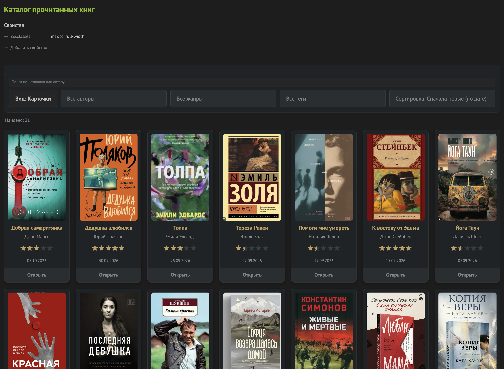
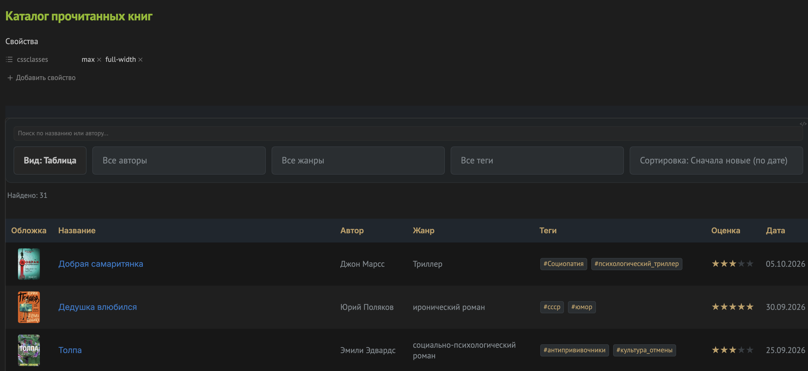

# Галерея книг для Obsidian

Скрипт для [Dataview](https://github.com/blacksmithgu/obsidian-dataview), который выводит заметки о книгах в виде карточек с обложками или таблицы. Есть поиск, фильтры по автору, жанру и тегу, сортировка и переключение вида. Папка с заметками и названия свойств задаются параметрами.

## Примеры

### Карточки



### Таблица



## Возможности

- Два вида: **карточки** и **таблица**. Выбор запоминается между сессиями.
- Поиск по названию и автору.
- Фильтры по автору, жанру и тегу, сортировка по дате и названию.
- Оценка показывается пятью звёздами, включая половинки. Шкала в заметках настраивается.
- В таблице клик по тегу включает фильтр, повторный клик снимает его.
- В карточках клик по обложке или кнопке «Открыть» открывает заметку.
- Название в таблице показывает превью при наведении (нужен включённый плагин «Предпросмотр страницы»).
- Опция: открывать заметку в новой вкладке или в текущей.

## Требования

- Плагин **Dataview** с включённой настройкой **Enable JavaScript Queries**.
- Файл `book-gallery.js` в любой папке хранилища, например `scripts/`.
- CSS-сниппет `book-gallery.css` в `.obsidian/snippets/`, включённый в настройках внешнего вида.

## Установка

1. Скопируйте `book-gallery.js` в папку `scripts/` хранилища (путь можно выбрать любой).
2. Скопируйте `book-gallery.css` в `.obsidian/snippets/` и включите сниппет: **Настройки → Внешний вид → CSS-сниппеты**.
3. Создайте заметку-каталог и вставьте в неё блок:

````markdown
```dataviewjs
await dv.view("scripts/book-gallery", { folder: "Прочитанные книги" })
```
````

Путь в `dv.view` указывается без расширения `.js` и относительно корня хранилища.

### Галерея на всю ширину (по желанию)

Чтобы каталог занимал всю ширину экрана, добавьте во frontmatter заметки классы `max` и `full-width` и подключите второй сниппет `full-width.css`:

```css
.full-width {
    --file-line-width: 100%;
}

.full-width .markdown-source-view.is-readable-line-width .cm-sizer,
.full-width .markdown-preview-view.is-readable-line-width .markdown-preview-sizer {
    max-width: 100% !important;
}
```

```yaml
---
cssclasses:
  - max
  - full-width
---
```

## Формат заметок о книгах

Каждая книга — отдельная заметка в нужной папке. Свойства (frontmatter):

| Свойство | Назначение | Пример |
|---|---|---|
| `Название` | Название. Если не задано, берётся имя файла | `Мастер и Маргарита` |
| `Автор` | Строка, список или ссылки. Несколько авторов можно перечислить через запятую | `Михаил Булгаков` |
| `Жанр` | Так же, как автор | `Роман, Классика` |
| `Оценка` | Число по шкале `ratingMax` (по умолчанию 0–10) | `9` |
| `Дата прочтения` | Дата | `2026-03-14` |
| `cover` | Обложка: вики-ссылка на файл, путь или URL | `"[[master.jpg]]"` |
| `Прочитано` | Флаг для фильтрации (можно отключить, см. параметры) | `true` |

Теги берутся из самой заметки (теги во frontmatter и в тексте).

Пример:

```yaml
---
Название: Мастер и Маргарита
Автор: Михаил Булгаков
Жанр: Роман, Классика
Оценка: 9
Дата прочтения: 2026-03-14
cover: "[[master.jpg]]"
Прочитано: true
tags: [проза]
---
```

## Параметры

Все параметры необязательные. Значения ниже используются по умолчанию.

```dataviewjs
await dv.view("scripts/book-gallery", {
    folder: "Прочитанные книги",
    filterField: "Прочитано",
    filterValue: true,
    fields: {
        title: "Название",
        author: "Автор",
        genre: "Жанр",
        rating: "Оценка",
        date: "Дата прочтения",
        cover: "cover"
    },
    ratingMax: 10,
    dateFormat: "dd.MM.yyyy",
    openInNewTab: true,
    defaultView: "cards",
    defaultSort: "date_desc",
    storageKey: "obsidian-book-gallery-view",
    searchDebounce: 150
})
```

| Параметр | Описание |
|---|---|
| `folder` | Папка с заметками. Подпапки включены |
| `filterField` | Свойство-флаг, по которому отбираются заметки. `null` или `""` — показывать все заметки из папки |
| `filterValue` | Значение флага, при котором заметка попадает в каталог |
| `fields` | Названия свойств. Переопределяйте только те, что отличаются, остальные сохранятся |
| `ratingMax` | Шкала оценки в заметках. В интерфейсе всегда 5 звёзд |
| `dateFormat` | Формат даты в стиле Luxon, например `dd.MM.yyyy` |
| `openInNewTab` | `true` — заметка открывается в новой вкладке, `false` — в текущей. Ctrl/Cmd+клик инвертирует настройку |
| `defaultView` | Вид по умолчанию: `"cards"` или `"table"`. Применяется, пока пользователь не переключил вид |
| `defaultSort` | `date_desc`, `date_asc`, `title_asc`, `title_desc` |
| `storageKey` | Ключ, под которым запоминается выбранный вид |
| `searchDebounce` | Задержка поиска при вводе, мс |

### Несколько каталогов

Скрипт можно подключать в разных заметках с разными параметрами. Задайте разные `storageKey`, чтобы выбранный вид у каталогов не пересекался:

```dataviewjs
await dv.view("scripts/book-gallery", {
    folder: "Хочу прочитать",
    filterField: null,
    storageKey: "book-gallery-wishlist"
})
```

## Настройка внешнего вида

Цвета заданы переменными в начале `book-gallery.css`. Для каждой темы Obsidian своя палитра: `body.theme-dark` и `body.theme-light`. Галерея переключается вместе с темой приложения.

```css
body.theme-dark {
    --bg-card: #22272a;     /* фон карточек и панели */
    --bg-input: #2e3438;    /* поля ввода, кнопки, теги */
    --bg-hover: #3a4247;    /* наведение */
    --bg-row-hover: #2a3034;/* строка таблицы при наведении */
    --border: #333a3e;
    --border-input: #3e464b;
    --accent: #c9a971;      /* названия, заголовки таблицы */
    --muted: #8a9297;       /* второстепенный текст */
    --star-on: #c9a971;     /* заполненная звезда */
    --star-off: #3e464b;    /* пустая звезда */
    --text-hover: #ffffff;
    --card-shadow: rgba(0, 0, 0, 0.3);
}
```

Тот же набор переменных есть в блоке `body.theme-light` с другими значениями. Чтобы сменить оформление, измените значения в нужном блоке.

## Если что-то не работает

- **Ничего не отображается.** Проверьте, что в Dataview включено **Enable JavaScript Queries** и путь в `dv.view` верный (без `.js`, от корня хранилища).
- **Список пустой.** Проверьте `folder` и `filterField`. Если у заметок нет свойства `Прочитано: true`, задайте `filterField: null`.
- **Нет обложек.** Файл обложки должен быть в хранилище, а в `cover` должна быть ссылка вида `"[[файл.jpg]]"`, путь или URL. В YAML вики-ссылку нужно заключать в кавычки.
- **Правки скрипта не видны.** Dataview не перерисовывает блок при изменении `.js`. Переключитесь на другую заметку и вернитесь или перезапустите Obsidian.
- **Заметка открывается не так, как задано.** Проверьте параметр `openInNewTab`. Из закреплённой вкладки Obsidian всегда открывает ссылки в новой.
- **Нет превью при наведении.** Включите основной плагин «Предпросмотр страницы» и проверьте, какая клавиша-модификатор для него настроена.

## Состав

| Файл | Назначение |
|---|---|
| `book-gallery.js` | Скрипт для `dv.view` |
| `book-gallery.css` | CSS-сниппет с оформлением |
| `full-width.css` | Необязательный сниппет для ширины на весь экран |
| `img/cards.png`, `img/table.png` | Скриншоты для README |
