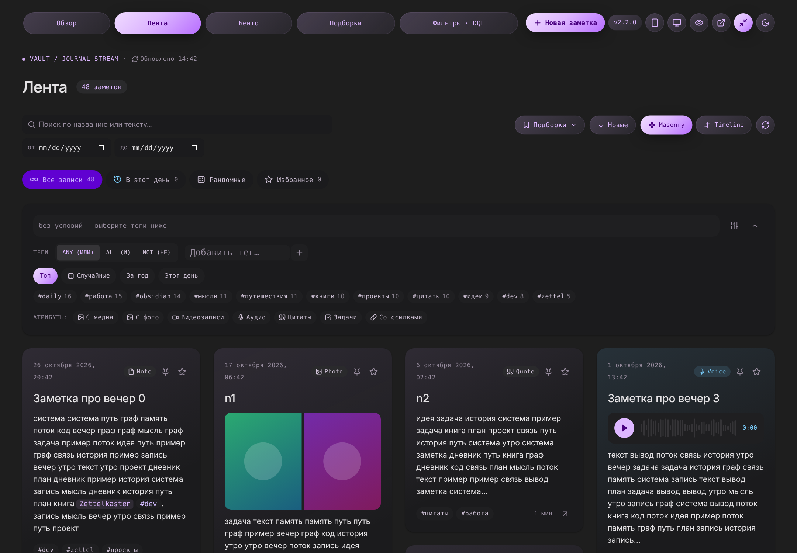
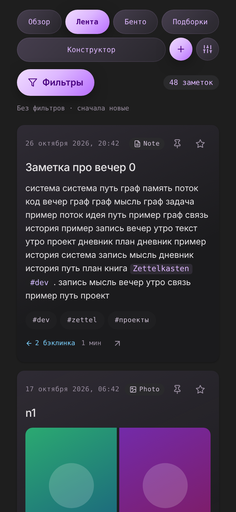

# Journal Stream — плагин Obsidian

**Версия 2.4.0** · [история версий](#история-версий) · исходник версии — `src/app/version.js` и `manifest.json`





> Скриншоты сняты в headless-Chromium на тестовых данных (`tests/browser/layout_check.py --shots`); замените их своими из Obsidian, если хотите.

Лента заметок в виде карточек «как в соцсети» по макетам *Obsidian Journal / Obsidian Stream*: поток (masonry / timeline), Bento-сетка,
смарт-подборки, конструктор фильтров с генератором DQL, обзор с пульсом месяца, поиск, мобильный интерфейс.
**Плагин без зависимостей**: Dataview не нужен, сборщик не нужен — это обычные файлы, которые достаточно скопировать в папку плагинов.

## Установка («скопировал — вставил»)

1. Создайте папку `<vault>/.obsidian/plugins/journal-stream/` и положите в неё **два файла** из архива: `manifest.json` и `main.js`.
   `main.js` — **собранный, самодостаточный**: все модули, стили и README встроены внутрь, папки `src/` и `css/` для работы не нужны (они в архиве — исходники для разработки).
   Свои правки стилей: создайте рядом файл `css/90-custom.css` — он подключается последним.
2. В Obsidian: **Settings → Community plugins** → отключите «Restricted mode», нажмите «Reload plugins» → включите **Journal Stream**.
3. Откройте ленту: иконка в левой панели (ribbon), команда **«Journal Stream: Открыть ленту»** или код-блок в заметке (см. ниже).
4. **Settings → Journal Stream** — укажите папки с заметками (по умолчанию `notes`; пусто — весь vault) и остальные параметры.

Структура после установки:

```
.obsidian/plugins/journal-stream/
├─ manifest.json
├─ main.js            ← собранный файл: модули, стили и README внутри
├─ css/90-custom.css  ← по желанию: ваши правки стилей
└─ data.json          ← создаётся сам: настройки, подборки, избранное, предпочтения UI
```

> Плагин работает на мобильном Obsidian (`isDesktopOnly: false`). Обновление — замена файлов в папке плагина с сохранением `data.json` и перезагрузка плагина (или Obsidian). Если изменили `css/90-custom.css` — достаточно закрыть и снова открыть вкладку либо изменить любую настройку.

## Как открыть ленту

* **Вкладка**: ribbon-иконка, команда «Открыть ленту» или «Открыть раздел: Обзор / Лента / Бенто / Подборки / Конструктор». Вкладка запоминает раздел, фильтры и прокрутку: открыли заметку, нажали «назад» — вернулись на то же место.
* **Блок в заметке** — встраивание ленты (например, на дашборд). Команда «Вставить блок journal-stream в заметку» добавляет заготовку.

````markdown
```journal-stream
view: stream
tags: мысли, daily
exclude: архив
period: 30d
nav: false
```
````

Параметры блока (одна строка — один параметр `ключ: значение`; все необязательны):

| Параметр | Значения | Что делает |
|---|---|---|
| `view` | `overview` `stream` `bento` `collections` `stats` `studio` (или по-русски: Обзор, Лента, Бенто, Подборки, Статистика, Конструктор) | стартовый раздел (по умолчанию — из настроек) |
| `layout` | `masonry` \| `timeline` | раскладка ленты |
| `theme` | `auto` \| `dark` \| `light` | тема блока |
| `nav` | `true` \| `false` | верхняя навигация (false — «чистый» экран без вкладок) |
| `fullWidth` | `true` \| `false` | на всю ширину заметки |
| `openInNewTab` | `true` \| `false` | открывать заметку по клику на карточку в новой вкладке |
| `popupView` | `true` \| `false` | открывать заметку в плавающем окне просмотра |
| `viewMode` | `auto` \| `mobile` \| `desktop` | принудительный вид |
| `tags` | список через запятую | заметки с любым из тегов (ANY) |
| `alltags` | список | заметки со всеми тегами (ALL) |
| `exclude` | список | исключить теги (NOT) |
| `period` | `7d` `14d` `30d` `90d` `year` `all`… | период |
| `search` | текст | стартовый поиск |
| `sort` | `date-desc` `date-asc` `mtime-desc` `backlinks-desc` `length-desc` `alpha-asc` | сортировка |
| `from` / `to` | `2026-01-01` | диапазон дат |
| `day` | `2026-10-01` | конкретный день |
| `id` | любая строка | ключ сохранения состояния: у нескольких блоков в одной заметке задавайте разные |

Неизвестный параметр или непонятная строка не ломают блок — над лентой показывается предупреждение. Можно держать несколько блоков на странице.
Страница с блоком по умолчанию растягивается на всю ширину (кнопка ⤢ в навигации переключает); когда вы открываете заметку кликом по карточке, полная ширина с этой страницы снимается.

## Настройки

**Settings → Journal Stream** (применяются сразу к открытым вкладкам; блоки в заметках — при следующей отрисовке). Все значения хранятся в `data.json`; полный список ключей — в таблице ниже.

| Группа | Что настраивается |
|---|---|
| Новая заметка | куда складывать (корень / папка / правило с датой), имя файла, открывать ли после создания |
| Источники | папки с заметками (по одной в строке; пусто — весь vault), исключённые папки и теги, поля даты, откуда брать время, теги избранного и цитат |
| Вид | раздел по умолчанию, тема, «на всю ширину», открытие заметок в новой вкладке, колонки min/max, минимальная ширина карточки, порог мобильного вида, размер «страницы» (десктоп / телефон), бейдж источника |
| Поиск и диагностика | фоновая индексация текстов, подробный лог (`debug`) |
| Данные | «Сбросить всё» (с подтверждением) |

## Экраны

| view | Что это | Из макетов |
|---|---|---|
| `overview` | **Пульс месяца** — 4 карточки: график накопления заметок (с динамикой к прошлому месяцу), стрик с кружками последних 7 дней, связи с плотностью графа, медиа (фото / видео / аудио) + полоса трендовых тегов; **случайные озарения** (3 / 6 / 9 / 12 карточек, выбор запоминается; 🎲 перемешивает); **годовой срез** — карта активности с подписями месяцев и дней недели, легендой и сводкой (клик по дню → лента) и кольцевая диаграмма типов заметок (клик по типу → лента) | Overview & Pulse |
| `stream` | Лента карточек: **строка поиска** (результаты сразу при вводе), меню **«Подборки»**, быстрые режимы (Все / В этот день / Рандомные 🎲 / Избранное), формула фильтра, конструктор тегов ANY/ALL/NOT, атрибуты, раскладки Masonry и Timeline | Flow Stream |
| `bento` | Те же данные в сетке-мозаике: у каждой плитки своя высота, видео и canvas шире (2 колонки), цитаты и аудио с цветным фоном. **Порядок — слева направо, затем сверху вниз** | Bento Grid |
| `collections` | Галерея смарт-подборок: правила, счётчик, мини-превью заметок **с двумя строками текста**; **вся карточка кликабельна и открывает подборку в Бенто** (кнопка «Лента» — в ленте); ✎ редактировать, 🗑 удалить (с подтверждением), 🎲 для случайных | Smart Collections |
| `studio` | Конструктор: название/иконка/режим, теги, атрибуты, период, порог бэклинков, сортировка, источники, поиск; справа — живой отклик (число и время) и готовый **DQL** с копированием. Панель действий вверху: **Сохранить**, **Сохранить как новую**, **Удалить**, Сбросить, Открыть в Бенто | Query Studio / Tag Builder |

## Состояние, прокрутка и сброс

* **Вернулись на страницу** (ушли открыть заметку и нажали «назад»): раздел, фильтры, быстрый режим, раскладка, «Показать ещё», текст поиска и **положение прокрутки** восстанавливаются. Позиция фиксируется в момент клика по карточке, а события прокрутки, которые Obsidian генерирует при смене заметки, игнорируются; восстановление повторяется, пока карточки дорисовываются. Состояние живёт в памяти окна Obsidian и **не пишется на диск** — после перезапуска Obsidian лента стартует с чистого листа.
* **Вход в раздел через навигацию** (Обзор → Лента → Бенто → Подборки → Фильтры) всегда начинается с дефолта: без фильтров, режим «Все», первая страница, **новый пустой конструктор**.
* Переходы «с переносом» не сбрасывают ничего: «Открыть подборку», клик по тегу на обзоре, клик по дню на карте активности, клик по типу в диаграмме, «Редактировать» подборку.
* На диск (в `data.json`, раздел `ui`) сохраняются только предпочтения: раскладка ленты и «на всю ширину».

## Поиск

Поиск **по названию или тексту** есть везде, где есть фильтры: в шапке «Ленты» и «Бенто» и отдельной строкой в панели «Фильтры». Результаты обновляются сразу при вводе (задержка 0,1 с); несколько слов — условие «И»; регистр и «ё/е» не важны.

Почему раньше находились не все записи: пока тексты заметок не прочитаны, поиск видит только заголовки и теги. Теперь индексация текстов стартует **сама** вскоре после открытия ленты (`autoIndex`), одна нечитаемая заметка её не прерывает, ищется весь текст заметки (а не превью), а рядом с полем виден прогресс «индексация N/M»; по завершении результаты пересчитываются автоматически. Если в результатах меньше записей, чем ожидалось, проверьте формулу над лентой (активные условия) и кнопку «Показать ещё» (за раз показывается `pageSize` карточек). Esc или ✕ очищают поле.

**Фильтр дат.** Рядом со строкой поиска два поля даты — «от» и «до». Текст, «от» и «до» — **три независимых параметра**: можно задать любой из них, любые два или все три; при изменении любого фильтр применяется сразу, границы включительны. Условия видны в формуле над лентой (каждое снимается крестиком) и попадают в DQL и в сохраняемые подборки. Дата заметки — та же, что в карточке (поле даты → имя файла → дата создания). Для больших vault индексация читает все заметки один раз за сеанс (⟳ сбрасывает индекс).

## Подборки: меню, сохранение, удаление

* **Меню «Подборки ▾»** в панели ленты/бенто: список сохранённых подборок со счётчиками — клик применяет подборку, не покидая экран. Внизу — поле «Название» и кнопка **Сохранить**: текущий фильтр и режим сохраняются как подборка.
* **Удаление**: 🗑 в меню, на карточке подборки или кнопка «Удалить» в конструкторе. Первый клик превращает кнопку в «Удалить?», второй — подтверждает (через 2,5 с подтверждение снимается).
* В **конструкторе** «Сохранить подборку» требует название; для открытой существующей подборки доступны «Сохранить изменения» и «Сохранить как новую».
* Подборки лежат в `data.json` (`presets`) и правятся руками.

## Раскладки

| | Что делает |
|---|---|
| **Masonry** (экран «Лента») | карточки разной высоты; каждая занимает самое короткое место (при равенстве — левее), поэтому порядок читается слева направо и сверху вниз, а высота «строки» ни к чему не привязана. Число колонок — `columns.min…max` по ширине блока |
| **Timeline** (экран «Лента») | лента по дням с вертикальной линией; внутри дня **по две карточки в ряд одинаковой высоты**, если ширины мало — по одной. Режим Flow удалён как дубликат Timeline (старое значение `flow` читается как `timeline`) |
| **Bento** (экран «Бенто», а также «Подборки») | тот же движок плиток, но видео/canvas (и первая подборка-«герой») занимают две колонки. Число колонок — те же `columns` |

Размер текста цитат — `--sf-quote-size` (по умолчанию `calc(17px / 1.5)`), меняется в `css/90-custom.css`.

## Типы карточек

Тип определяется автоматически (приоритет сверху вниз), либо явно через frontmatter `type: audio|video|image|quote|tasks|link|canvas|text`.

| Тип | Условие | Тело карточки |
|---|---|---|
| video | в заметке встроено видео (`![[x.mp4]]`) | плеер + текст |
| audio | встроено аудио (`![[x.m4a]]`) | плеер с «волной» и прогрессом + текст |
| canvas | встроен `.canvas` | плитка «Открыть в Canvas» + текст |
| image | встроены изображения | сетка до 4 фото в рамке 16:10, centerCrop (обрезка по центру), «+N»; при наведении не меняется |
| quote | тег из `quoteTags` (`#цитата`…) или цитаты занимают > 40% текста | крупная цитата (`> [!quote] Автор`) + остальной текст |
| tasks | ≥ 2 задач `- [ ]` | прогресс-бар + первые 6 задач |
| link | внешний URL и < 45 слов | превью ссылки (домен/адрес) |
| text | всё остальное | markdown-превью (обрезается «…»; открыть заметку целиком — клик по карточке) |

Вики-ссылки `[[…]]` внутри текста стилизуются как в `DESIGN.md` (моно-шрифт, фиолетовая плашка). В подборках и живом отклике заметки показываются как **rich-link** с иконкой типа, датой и числом связей.

**Дата и время** в карточке показываются в формате самих заметок: «1 октября 2024, 16:12». Дата берётся из первого найденного поля `dateFields` (frontmatter), иначе из имени файла (`YYYY-MM-DD`), иначе из даты создания файла. Распознаются форматы `2024-10-01 16:12`, `2024-10-01T16:12`, `01.10.2024 16:12` и русские `1 октября 2024, 16:12` / `1 окт 2024 г. в 16:12`. Если в поле даты нет времени, оно берётся из отдельного поля `time` / `время`; можно также включить `timeFallback: "ctime"` (или `"mtime"`) — тогда время подставляется из даты создания (изменения) файла. Без времени показывается только дата.

## Клики по карточке

Режим «плавающее окно просмотра» (кнопка-глаз в шапке / настройка `popupView`) открывает заметку в окне чтения поверх ленты — см. v2.2.0; Ctrl/Cmd+клик всегда открывает в редакторе.

* **Клик по карточке** (по свободному месту) открывает заметку; по тегу, ссылке, кнопке, плееру — срабатывает сам элемент. Вкладку выбирает настройка «открывать в новой вкладке» (кнопка в навигации, `openInNewTab`); Ctrl/Cmd+клик или средняя кнопка — всегда новая вкладка.
* **Клик по тегу** (чип в футере карточки или `#тег` в тексте) применяет тег **на этой странице** как фильтр — глобальный поиск Obsidian не открывается. В «Обзоре» и «Подборках» клик по тегу переносит в ленту с этим фильтром.
* `[[Вики-ссылки]]` внутри текста открываются по тем же правилам, что и заголовок.

## Мобильная версия

Интерфейс подстраивается под ширину самого блока: **< 560px** — один столбец и мобильный интерфейс (`is-mobile`), **< 900px** — компактный (`is-compact`). На телефоне экран максимально освобождён — в «Ленте» и «Бенто» остаются только три вещи:

1. **Разделы** — кнопки идут потоком и переносятся на новую строку, если не хватает места (никакой прокрутки); рядом круглая кнопка **⚙ «Настройки»**.
2. **Кнопка «Фильтры (N)»** — открывает **модальное окно** со всеми фильтрами: условия «Применено», поиск и даты (от/до), режим (Все / В этот день / Рандомные / Избранное), подборки, теги (Топ / Случайные / За год / Этот день), атрибуты, условия (период, связи, сортировка, источники), порядок и вид (Новые/Старые, Masonry/Timeline). Фильтры применяются сразу; нижняя панель: «Сбросить», «Перечитать хранилище» и «Показать N заметок» (закрывает окно). Esc, ✕ или тап по затемнению тоже закрывают его.
3. **Краткая сводка** применённых условий (подборка, режим, теги, атрибуты, поиск, даты, период…) и число заметок; тап по сводке открывает то же окно. Нет условий — «Без фильтров · сначала новые».

**«Настройки»** (⚙) — окно с переключателями, которые на телефоне не занимают место в шапке: вид (авто / мобильный / десктопный), тема (как в Obsidian / светлая / тёмная), открывать заметки в новой вкладке, страница на всю ширину, версия со ссылкой на историю.

Остальное на телефоне: карта активности на обзоре — за последние 26 недель и помещается в ширину; блок кода DQL переносится по строкам; длинные теги и названия сжимаются с многоточием; карточек за раз — `pageSizeMobile`; крупные цели касания; поля 16px (iOS не увеличивает страницу). **Горизонтальной прокрутки нет** — ни у страницы, ни внутри виджета (проверяется в реальном браузере, см. «Тесты»). «Конструктор» (`studio`) на телефоне сохраняет обычную панель фильтров. Оформление — `css/85-responsive.css`, `css/36-modal.css`.

## Теги, сортировка и атрибуты

* **Наборы тегов** (вкладки над чипами в панели фильтров): **Топ** — самые частые; **Случайные** — случайная выборка, повторный клик перемешивает; **За год** — самые частые за последние 12 месяцев; **Этот день** — теги заметок, написанных в этот день в прошлые годы. Поле ввода с автодополнением ищет по всем тегам вне зависимости от набора.
* **Сортировка по времени**: кнопка «Новые ↓» / «Старые ↑» в шапке ленты и бенто; по умолчанию — сначала новые. Другие варианты сортировки (связи, длина, алфавит) — в «Условиях» панели и в конструкторе.
* **Атрибуты** (С медиа, Фото, Видео, Аудио, Цитаты, Задачи, Со ссылками) — единственный способ фильтровать по виду контента; прежний ряд «Тип» убран как дублирующий.

## Мобильный и десктопный вид вручную

В правой части навигации две кнопки: 📱 «мобильный вид» и 🖥 «десктопный вид». **Мобильный** показывает интерфейс как на телефоне даже на компьютере (узкая рамка по центру, один столбец, фильтры свёрнуты) — удобно проверять и настраивать. **Десктопный** показывает колонки (`columns.min…max`) и широкую шапку даже на узком экране телефона (блок не уже 760px, страницу можно прокрутить вбок). Повторный клик по включённой кнопке возвращает автоопределение по ширине. Выбор запоминается в `data.json` (`ui.viewMode`: `auto` \| `mobile` \| `desktop`), задать вручную можно и параметром code-блока `viewMode: mobile`.

## Тема и фон

Кнопка темы в навигации — иконка (☾ / ☀), переключает тёмную/светлую тему виджета. Когда вы переключаете тему самого Obsidian, выбор виджета сбрасывается на «auto» и снова следует глобальной теме. У виджета нет собственного цвета фона — виден фон заметки; чтобы вернуть, добавьте в `css/90-custom.css`: `.sf-root { --sf-root-bg: var(--sf-canvas); }`.

## Тема и оформление

Оформление построено по `dashboard.html`: тональные слои без рамок, карточки со скруглением 1rem, при наведении фон карточки становится светлее, pill-фильтры, моно-чипы правил, акцентная кнопка. Переключатель темы «Тёмная / Светлая» — в правой части навигации (запоминается); `auto` следует теме Obsidian.

## Кнопка «Наверх»

После прокрутки вниз на 400px в правом нижнем углу прокручиваемой области заметки появляется круглая кнопка ↑ (акцентный градиент); клик плавно возвращает к началу страницы. Кнопка технически живёт в `<body>` (`position: fixed`) и сама подстраивает положение под область заметки.

## Формат фильтра

```json
{ "any": ["мысли", "zettel"], "all": [], "not": ["архив"],
  "attrs": ["media", "task"], "types": ["audio"], "sources": ["lj"],
  "period": "30d", "dateFrom": "2026-01-01", "dateTo": "2026-05-31", "day": "2026-05-14", "minBacklinks": 3, "text": "", "sort": "date-desc" }
```

* `any` — хотя бы один тег (OR); `all` — все теги (AND); `not` — ни одного (NOT). Группы соединяются через AND. Тег `a` совпадает и с `a/b`.
* `attrs`: `media photo video audio quote task link`. `period`: `all 7d 14d 30d 3m 1y`.
* `sort`: `date-desc date-asc mtime-desc backlinks-desc length-desc alpha-asc`.
* Быстрый режим (`quick`): `all | today | random | favorites`, применяется после фильтра; `random` берёт `randomCount` записей, «Перемешать» меняет только seed.

## Данные — файл `data.json`

**Что это.** `<vault>/.obsidian/plugins/journal-stream/data.json` — единственный рабочий файл плагина: настройки, смарт-подборки, избранное/закрепы и предпочтения интерфейса (раскладка, ширина, тема, вкладка). Создаётся сам при первом запуске; его же правит вкладка настроек и интерфейс ленты.
**Как сбросить всё в дефолт.** Кнопка **«Сбросить всё»** в настройках плагина — либо отключите плагин, **удалите `data.json`** и включите снова. Код и CSS лежат отдельно; заметки плагин **никогда не изменяет**.

```json
{
  "version": 3,
  "appVersion": "2.4.0",
  "settings": { "...": "настройки (см. ниже)" },
  "ui":       { "layout": "masonry", "fullWidth": true, "openInNewTab": false, "theme": "dark", "viewMode": "auto" },
  "presets":  [ { "id": "...", "name": "...", "icon": "bolt", "description": "...", "quick": "all", "filter": { } } ],
  "flags":    { "notes/путь/к/заметке.md": { "favorite": true, "pinned": true } }
}
```

Избранное и закрепы живут в `flags`. Заметка также считается избранной, если у неё `favorite: true` во frontmatter или тег из `favoriteTags`. Файл можно править руками (плагин нужно перезагрузить); после правок убедитесь, что JSON валиден.

### Ключи настроек (`settings`)

| Ключ | По умолчанию | Описание |
|---|---|---|
| `sources` | `notes` | `[{id, label, folder, enabled}]`; пустой `folder` = весь vault |
| `excludeFolders` / `excludeTags` | `scripts`, `.obsidian`, `templates` / — | что не показывать |
| `dateFields` | `date, Date, created, дата, Дата, datetime, …` | поля frontmatter с датой (по порядку); формат — ISO или русский («1 октября 2024, 16:12»); если нет — дата из имени файла (`2024-10-01`) или создания |
| `timeFallback` | `none` | откуда брать время, если в дате его нет: `none` \| `ctime` \| `mtime` (ещё читается поле `time`/`время`) |
| `openInNewTab` | `false` | открывать заметку по клику на карточку в новой вкладке |
| `hideSidebar` / `restoreSidebar` | `none` / `true` | скрывать боковые панели при открытии вкладки с лентой: `none` \| `left` \| `right` \| `both`; возвращать при закрытии |
| `popupView` | `false` | открывать заметку в плавающем окне просмотра (не в редакторе); бэклинки на карточках скрыты; Ctrl/Cmd+клик — в редакторе |
| `quoteTags`, `favoriteTags`, `favoriteField` | `цитата…`, `избранное…`, `favorite` | как распознавать цитаты и избранное |
| `columns` | `{ "min": 2, "max": 4 }` | число колонок карточек на десктопе (masonry и бенто) |
| `minCardWidth` | `320` | минимальная ширина карточки, px: по ней считается, сколько колонок помещается; результат ограничивается `min`/`max` |
| `fullWidth` | `true` | на всю ширину (также кнопка ⤢ в навигации, запоминается) |
| `newNote` | `{mode: "folder", folder: "notes", rule: "%%FOLDER_NAME/YYYY/YYYY-MM-MMMM/YYYY-MM-DD-hh-mm", fileName: "YYYY-MM-DD-hh-mm", open: true}` | куда создаётся «Новая заметка»: `mode` = `root` \| `folder` \| `rule`; токены правила: `YYYY MM MMMM DD D hh mm`, `%%FOLDER_NAME` = `folder` |
| `theme` / `nav` / `defaultView` / `layout` | `auto` / `true` / `stream` / `masonry` | оформление и стартовые экраны |
| `pageSize`, `pageSizeMobile`, `excerptChars`, `randomCount`, `insightsCount`, `insightsOptions`, `topTags` | 24, 12, 420, 12, 3, [3, 6, 9, 12], 24 | размеры выборок |
| `singleColumnBelow` | `560` | ширина блока (px), ниже которой включается один столбец и мобильный интерфейс |
| `concurrency` | 8 | сколько заметок читать параллельно |
| `debug` | `false` | подробный лог восстановления прокрутки в консоль (Ctrl+Shift+I) |
| `autoIndex` | `true` | после открытия ленты в фоне индексировать тексты заметок — поиск находит и по тексту, а не только по заголовкам и тегам |
| `deepScan` | `false` | прочитать тела **всех** заметок в фоне при открытии (точные типы/цитаты сразу; медленнее на больших vault) |
| `showSourceBadge` | `false` | бейдж источника на карточке (при нескольких папках) |
| `dql.dateExpr` | `file.cday` | какое выражение даты подставлять в DQL (раздел «Конструктор» — генератор запроса для Dataview; сам плагин Dataview не использует) |

> Без `deepScan` тип карточки и атрибуты «цитаты/ссылки» определяются по тегам/вложениям (из `metadataCache`), а точно — после чтения тела при отрисовке карточки; поиск по тексту использует фоновую индексацию.

## Откуда берутся данные заметки

| Что | Источник в Obsidian |
|---|---|
| дата | frontmatter (`dateFields`) → имя файла → дата создания файла |
| заголовок | frontmatter `title`, иначе имя файла |
| теги | теги в тексте + `tags`/`tag` во frontmatter |
| связи / обратные ссылки | `metadataCache.resolvedLinks` (вложения и ссылки / кто ссылается) |
| задачи | `listItems` с чекбоксами |
| медиа | вложения из `resolvedLinks` по расширению (фото, видео, аудио, canvas) |
| тело заметки | `vault.cachedRead` — лениво, только для показанных карточек и индексации поиска |

Список заметок перечитывается при изменениях vault (с задержкой), по кнопке ⟳ в тулбаре и командой «Перечитать хранилище».

## CSS — `css/`

Файлы подключаются одним `<style>` по алфавиту имён (плагин читает их из своей папки при запуске и при смене настроек):

| Файл | Содержимое |
|---|---|
| `00-tokens.css` | **все** цвета, радиусы, шрифты (светлая + тёмная тема); `--sf-quote-size`, `--sf-surface-hover` |
| `10-base.css` | корень, кнопки, чипы, поля ввода, пустые состояния |
| `12-host.css` | размещение в Obsidian: вкладка плагина, code-блок, окно истории версий |
| `15-fullwidth.css` | режим «на всю ширину» (`.is-full`, `.sf-page-full`) |
| `20-shell.css` | навигация, тулбар, крошки, сегменты раскладок |
| `30-filters.css` | быстрые режимы, панель фильтров, формула, тег-билдер |
| `35-menu.css`, `36-modal.css` | поиск и меню «Подборки»; модальные окна |
| `40-card.css` / `41-card-types.css` | карточка и тела по типам, rich-link |
| `45-skeleton.css` | шиммеры загрузки |
| `50-feed.css` | masonry, timeline, bento |
| `60-overview.css`, `70-collections.css`, `80-studio.css` | соответствующие экраны |
| `85-responsive.css` | desktop ≥1280 · tablet 768–1279 · mobile <768 |
| `90-custom.css` | **ваши** переопределения (подключается последним) |

Тема `auto` следует теме Obsidian. Классы начинаются с `sf-` и не затрагивают остальной интерфейс.

## Структура

```
journal-stream/
├─ manifest.json           id, версия, minAppVersion
├─ main.js                 СОБИРАЕТСЯ: node tools/build.js (src + css + README внутри, ничего больше не нужно)
├─ tools/
│  ├─ build.js             сборщик main.js (без зависимостей)
│  └─ main.template.js     класс Plugin + CommonJS-загрузчик (из src/ или из встроенного bundle)
├─ src/
│  ├─ plugin/              слой Obsidian
│  │  ├─ index.js          сборка: ядро, вид, code-блок, команды, настройки, события vault
│  │  ├─ view.js           ItemView — вкладка «Journal Stream»
│  │  ├─ code-block.js     ```journal-stream
│  │  ├─ block-params.js   разбор параметров блока
│  │  ├─ settings-tab.js   вкладка в Settings
│  │  └─ commands.js       ribbon и команды палитры
│  ├─ app/                 композиция приложения
│  │  ├─ main.js           createCore(plugin) — один раз; mount(core, …) — на каждый вид/блок
│  │  ├─ shell.js          корень, тема, переключение экранов, восстановление прокрутки, toast, освобождение ресурсов
│  │  ├─ state.js          реактивный стор (восстановление из session, UI-предпочтения → data.json)
│  │  ├─ version.js        версия кода (единственный источник)
│  │  ├─ actions.js        ВСЕ изменения состояния (enterView — со сбросом, openPreset/jumpToTag — с переносом)
│  │  └─ open-note.js      открытие заметки (Ctrl/Cmd — новая вкладка)
│  ├─ lib/                 чистые утилиты: dom, icons, date, ru, text, random, store, async, layout, search, misc
│  ├─ model/               post.js (страница → пост), analyzer.js (разбор тела), media-kinds.js
│  ├─ types/               реестр типов карточек: video audio canvas image quote tasks link text
│  ├─ filters/             state, predicates, engine, sorters, periods, attrs, quick-modes, pipeline, formula, summary, dql, presets
│  ├─ stats/               activity (карта, стрик, легенда), period (пульс месяца), tags, types
│  ├─ services/            db (общая база data.json), storage, notes (metadataCache → страница), posts, session, scroll,
│  │                       indexer, css-loader, md (MarkdownRenderer), changelog, media, content, flags, presets, theme-watch, config
│  ├─ ui/                  common, card, feed, filters, overview, collections, studio (только отрисовка и вызов ctx.actions)
│  └─ views/               overview, stream, bento, collections, studio, feed-view (фабрика), index
├─ css/                    см. таблицу выше
├─ img/                    desktop.png, mobile.png — скриншоты для README
├─ tests/                  run.js, fake-dom.js, fake-app.js, fake-obsidian.js, fixtures.js, browser/ — в Obsidian не загружаются
└─ README.md
```

Правила слоёв: `lib`, `model`, `types`, `filters`, `stats` — чистые функции без DOM и Obsidian API (тестируются в Node); `services` — доступ к vault/metadataCache/файлам; `ui` — отрисовка и вызов `ctx.actions`; `views` — сборка экранов; `plugin` — единственный слой, который знает про `Plugin`, `ItemView`, `PluginSettingTab`.
Модуль подключается как `require("lib/dom")` (путь от `src/`); `require("obsidian")` возвращает API Obsidian. Новые `.js` файлы в `src/` подхватываются автоматически — список модулей нигде не ведётся.

## Как расширять

* **Новый тип карточки**: `src/types/<id>.js` (`{id, label, icon, match(post, feats)}`), включите в `types/index.js` (порядок = приоритет), добавьте `ui/card/bodies/<id>.js` с `render(ctx, post, feats, el)` и перечислите в `ui/card/bodies/index.js`; стили — в `css/41-card-types.css`.
* **Новый экран**: `views/<id>.js` → `{id, title, icon, render(ctx, el)}` (можно вернуть функцию-деструктор), добавьте в `views/index.js`.
* **Новое условие фильтра**: функция в `filters/predicates.js`, поле в `filters/state.js` (`defaultFilter`), при необходимости — в `formula.js` и `dql.js`.
* **Новая настройка**: значение по умолчанию в `services/config.js` + поле в `plugin/settings-tab.js`.
* **Новая команда**: `plugin/commands.js`.
* **Своё оформление**: `css/90-custom.css` или переменные `--sf-*` из `00-tokens.css`.

## История версий

Номер версии показан на странице (бейдж `v2.4.0` в навигации; при `nav: false` — внизу) и по клику открывает это окно. После обновления плагина при первом открытии показывается уведомление «обновлён: vX → vY». Версия записывается в `data.json` (поле `appVersion`).

### v2.4.0 — 2026-10-27
- **Подборки: сортировка.** В шапке раздела — список и кнопка направления. Варианты: «Мой порядок», «По количеству заметок», «По свежести (последняя заметка)», «По активности за 30 дней», «По дате создания подборки», «По названию». Выбор запоминается (`ui.collSort`, `ui.collDir` в `data.json`). Первая плитка после сортировки — «герой» на две колонки.
- **Конструктор: кнопка «К подборкам»** в шапке — из редактирования подборки (или нового фильтра) можно вернуться к списку, не закрывая плагин.
- Подборки получили поле `createdAt`: у новых — момент сохранения, у встроенных и сохранённых ранее — момент первого запуска этой версии (с сохранением их порядка).

### v2.3.5 — 2026-10-27
- **Статистика: разрез по годам — выпадающий список** вместо горизонтальной полосы кнопок, которая не помещалась на экран («Общее» и годы с числом заметок). На мобильном список занимает всю ширину.
- График «По годам» при большом числе лет подписывает не каждый столбец, а каждый N-й — подписи больше не наезжают друг на друга.

### v2.3.4 — 2026-10-27
- **Кнопка «назад» на телефоне закрывает окно заметки.** Если в окне открыто несколько заметок (переходы по внутренним ссылкам), «назад» сначала возвращает к предыдущей, на первой — закрывает окно. Окно регистрирует область клавиатуры Obsidian (Escape, как у штатных модальных окон) и слушает `popstate` веб-вью.

### v2.3.3 — 2026-10-27
- **Статистика: разрез по годам.** Над графиками «Когда вы пишете» и «По дням недели» появился переключатель «Общее / 2026 / 2025 / …». «Общее» — по выбранному периоду, годы — разрез по конкретному году; в подзаголовках указан год. Выбор запоминается на время сессии.

### v2.3.2 — 2026-10-27
- **Исправлена дата «14 января 1970».** Числовая дата в Unix-секундах (например `1200000000`) читалась как миллисекунды. Теперь числа и строки из 9–10 цифр понимаются как секунды, из 12–13 — как миллисекунды.
- Любая дата раньше 1980 года считается ошибкой данных: запись берёт дату из имени файла или даты создания, а не уходит в 1970 год. Это работает во всех разделах, не только в статистике.

### v2.3.1 — 2026-10-27
- **Статистика: исправлена дата 1970.** Заметки без даты (ts = 0) больше не попадают в расчёты: все показатели считаются от первой датированной записи. Их число показано в подзаголовке («без даты, не учтены: N»).
- **«Самые длинные записи»**: переключатель «Всё время» / «{текущий год}» / «По годам» — в последнем режиме показана самая длинная запись каждого года.
- **Итоги**: отдельные плитки «заметок за все годы» и «заметок в {год} году»; график «По годам» всегда по всем годам, независимо от выбранного периода.

### v2.3.0 — 2026-10-27
- **Новый раздел «Статистика»** (`view: stats`): мини-статистика по автору.
  - Итоги: заметок, активных дней, заметок за активный день, в неделю. Период: всё время / этот год / 12 месяцев.
  - График «Когда вы пишете» по часам суток (только записи, где указано время) и по дням недели (с понедельника); пик подсвечен.
  - Рекорды: лучшая и текущая серия дней подряд, самый плодотворный день и месяц, самая долгая пауза. Клик по рекорду открывает ленту на этом дне/месяце.
  - «Самые длинные записи» — топ-10 по числу слов, клик открывает заметку; график «По годам».
  - Раздел адаптивен (на мобильном рекорды в два столбца), расчёты — чистые функции в `src/stats/author.js`.

### v2.2.1 — 2026-10-27
- **Окно просмотра — по центру с затемнением** основного контента (лёгкое размытие); клик по затемнению или Esc закрывает, окно по-прежнему можно перетаскивать и менять его размер.
- **Скрывать боковую панель при открытии ленты**: Settings → Journal Stream → «Скрывать боковую панель» (не скрывать / левую / правую / обе, ключ `hideSidebar`) и «Возвращать панель при закрытии» (`restoreSidebar`, по умолчанию да). Действует для вкладки с лентой, не для код-блока.

### v2.2.0 — 2026-10-27
- **Плавающее окно просмотра заметки** (опция «Открывать заметки в плавающем окне» в настройках плагина, кнопка-глаз в шапке ленты, «Плавающее окно просмотра» в «Настройках» на телефоне; параметр блока `popupView: true`, ключ `popupView`). Клик по карточке показывает заметку в режиме чтения в окне по центру поверх затемнённой ленты, а не в редакторе: окно перетаскивается за заголовок, меняет размер за угол, закрывается по Esc или крестиком; на телефоне — нижняя шторка. Кнопка ↗ — открыть в редакторе; **Ctrl/Cmd+клик** по карточке — тоже в редакторе. Внутренние ссылки заметки открываются в этом же окне (кнопка «назад»), клик по тегу применяет фильтр ленты.
- В этом режиме **ссылки вперёд и назад скрыты**: на карточках и в мини-превью подборок нет счётчика бэклинков, в шапке окна — только дата и теги.

### v2.1.4 — 2026-10-23
- Новая заметка создаётся **только с атрибутом даты** (`date`): пустое свойство `tags` больше не добавляется.

### v2.1.3 — 2026-10-22
- **Язык месяца в названиях папок — в настройках**: `newNote.folderLang`, по умолчанию **English** → `notes/2026/2026-10-October/2026-10-22-00-31`; `ru` → `2026-10-Октябрь`. Отдельно — язык месяца в дате заметки (`newNote.dateLang`, по умолчанию `ru`: «16 октября 2026, 18:14»).

### v2.1.2 — 2026-10-22
- **Дата новой заметки задаётся правилом** (Settings → «Новая заметка» → «Дата в заметке», ключ `newNote.dateRule`). По умолчанию `D MMMM YYYY, hh:mm` → `16 октября 2026, 18:14` (месяц после «D » — в родительном падеже). Токены: `YYYY`, `MM`, `MMMM`, `DD`, `D`, `hh`, `mm`. Пример пути и даты показывается в настройках.
- **Контраст градиентных кнопок**: подпись на заливке всегда берёт `--sf-primary-on` (стили темы Obsidian больше не делают её бледной); заливка в светлой теме темнее — белый текст читается.

### v2.1.1 — 2026-10-22
- **Установка из двух файлов**: `main.js` теперь собирается (`node tools/build.js`) в самодостаточный файл — модули, CSS и README внутри; достаточно `manifest.json` + `main.js`. Исправляет `ENOENT`/«не найдена папка src/» при неполном копировании. Папки `src/`, `css/` остаются исходниками; `css/90-custom.css` рядом с `main.js` по-прежнему подхватывается.
- Загрузчик модулей встроен в `main.js` (`tools/main.template.js`); `src/core` удалён.

### v2.1.0 — 2026-10-22
- **Кнопка «Новая заметка»** в шапке (на телефоне — «＋» рядом с «Настройками») и команда палитры. Создаёт заметку с frontmatter (`date: "16 октября 2026, 18:14"` — формат задаётся правилом; **других свойств и тегов нет**) и открывает её; существующий файл не затирается (добавляется суффикс `-2`).
- **Куда складывать** — Settings → Journal Stream → «Новая заметка»: в корень vault; в папку; по правилу, например `%%FOLDER_NAME/YYYY/YYYY-MM-MMMM/YYYY-MM-DD-hh-mm` (`%%FOLDER_NAME` — папка из настроек; токены YYYY, MM, MMMM — месяц словом, DD, hh, mm). Под полями показан пример получающегося пути.
- Выравнивание по вертикали: кнопки справа от поиска стоят на одной линии с полем поиска, правая группа шапки — по верхней строке вкладок.

### v2.0.0 — 2026-10-21
**Виджет Dataview превращён в плагин Obsidian** (установка «скопировал — вставил», без сборщика: `main.js` + `src/*`).
- **Без Dataview.** Заметки читаются из `metadataCache` (frontmatter, теги, ссылки, задачи, `resolvedLinks` для обратных ссылок) — список пересобирается при изменениях vault.
- **Отдельная вкладка** «Journal Stream» (ribbon-иконка и команда «Открыть ленту»); состояние и прокрутка сохраняются при переходе в заметку и возврате.
- **Code-блок** ```` ```journal-stream ```` для встраивания в заметки: `view`, `tags`, `exclude`, `period`, `search`, `layout`, `theme`, `nav`, `fullWidth`…
- **Вкладка настроек** в Obsidian: папки-источники, исключения, поля даты, цвета/теги, колонки, ширины, индексация, сброс. Применяется сразу.
- **Команды**: открыть ленту, по одному разделу (Обзор / Лента / Бенто / Подборки / Конструктор), вставить блок, перечитать хранилище.
- **Данные — `data.json`** плагина (`loadData/saveData`); удалите файл или нажмите «Сбросить» в настройках — всё вернётся к умолчаниям.
- Окно **«История версий»** по клику на бейдж версии (берётся из этого README).
- Корректное освобождение ресурсов при закрытии вкладки/блока (слушатели, таймеры, кнопка «Наверх»).
- Тесты адаптированы под API плагина (+ новые для вкладки, code-блока, настроек, чтения из metadataCache).
- **Миграция с виджета 1.x**: `data/social_feed.json` не импортируется автоматически — перенесите настройки в окно настроек плагина (подборки можно скопировать в `data.json`, раздел `presets`), старую папку `scripts/social_feed` и dataviewjs-блоки можно удалить.

### v1.6.0 — 2026-10-19
Мобильный интерфейс в один экран.
- **Лента и Бенто на телефоне** — только разделы, кнопка «Фильтры (N)» и краткая сводка применённых условий. Все фильтры (поиск, даты, режим, подборки, теги, атрибуты, условия, порядок и вид) — в **модальном окне**; фильтры применяются сразу, «Показать N» закрывает окно.
- **Разделы потоком**: кнопки переносятся на новую строку (без прокрутки); служебные переключатели (вид, тема, вкладка, ширина, версия) вынесены в окно **«Настройки»** (⚙). Короткая подпись конструктора — «Конструктор» (не путается с кнопкой «Фильтры»).
- **Нет горизонтальной прокрутки** на телефоне и планшете: карта активности — 26 недель на телефоне, ячейки тянутся по ширине; DQL переносится по строкам; длинные теги и названия сжимаются; вкладки переносятся. Исправлена установка CSS-переменных через `style` в `h()`.
- **Проверка раскладки в реальном браузере** (`tests/browser/layout_check.py`, Playwright/Chromium): 8 ширин × все экраны × обе темы + стресс-данные + окна «Фильтры» и «Настройки».
- README: скриншоты `img/desktop.png` и `img/mobile.png` в начале.

### v1.5.0 — 2026-10-18
- **Теги — «подкладки» наборов**: Топ · Случайные (повторный клик перемешивает) · За год · Этот день (теги заметок, написанных в этот день в прошлые годы). Выбранные теги всегда остаются первыми.
- **Порядок по времени** в ленте и бенто: кнопка «Новые ↓ / Старые ↑» в шапке (по умолчанию — сначала новые).
- **Фильтры**: остались только атрибуты, ряд «Тип» убран (он дублировал атрибуты); клик по типу в диаграмме обзора и стандартные подборки теперь ставят атрибут. Подпись «FORMULA» убрана.
- **Панель фильтров** компактнее: переключатели «Условия» и «Свернуть/Развернуть» — только иконки (на телефоне — кнопка «Фильтры (N)»). Защита от горизонтальной прокрутки на планшете (`overflow-x: clip`, перенос диапазона дат, сжимаемые элементы шапки).
- «В этот день» — без даты в названии кнопки.
- **Тема**: кнопка темы — только иконка (без подсказки и подписи); при переключении темы Obsidian выбор темы в виджете сбрасывается на «auto» (глобальная тема).
- **Фон**: у самого виджета нет цвета фона — виден фон заметки Obsidian (вернуть: `.sf-root { --sf-root-bg: var(--sf-canvas); }` в `css/90-custom.css`).

### v1.4.0 — 2026-10-17
- **Фильтр дат «от» и «до»** рядом со строкой поиска (в шапке ленты/бенто и в панели конструктора). Текст, «от» и «до» — три независимых параметра: изменение любого сразу применяет фильтр; границы включительно; каждая дата снимается крестиком в формуле. Поддержан в DQL и в сохраняемых подборках (`dateFrom`, `dateTo`).
- **Кнопка «Наверх»** (исправление): теперь `position: fixed` в `<body>` с положением по прокручиваемой области заметки — раньше `sticky` не срабатывал, если у родителя есть `overflow`. Появляется после 400px прокрутки; при перерисовке блока и уходе со страницы не плодится и убирается.
- **Картинки** (исправление): centerCrop — рамка фиксированных пропорций 16:10, картинка заполняет её и обрезается по центру; при наведении ничего не меняется (убраны масштаб, фильтр и зависимость от естественного размера).

### v1.3.0 — 2026-10-17
- **Верхние кнопки** (вкладки разделов, кнопки справа, «Подборки», раскладки, главная кнопка) — скруглённые «пилюли» в цвет акцента с градиентом: неактивные — мягкий градиент, активная — полная заливка. Все кнопки на месте и на телефоне (кнопку ширины больше не прячем).
- **Мобильный / десктопный вид вручную**: кнопки 📱 и 🖥 в навигации. «Мобильный» — как на телефоне даже на компьютере (узкая рамка, один столбец, свёрнутые фильтры); «десктопный» — колонки по `columns` даже на телефоне (блок не уже 760px). Повторный клик возвращает автоопределение; выбор запоминается (`ui.viewMode`).
- **Прокрутка при возврате** (исправление): контейнер прокрутки определяется надёжно — по событиям прокрутки, подсказке из прошлого сеанса и известным контейнерам Obsidian; «ложные» обёртки с `overflow:auto` больше не дают `scrollTop = 0` при клике по карточке. Позиция удерживается 3 с после восстановления. `debug: true` в настройках пишет ход восстановления в консоль.

### v1.2.0 — 2026-10-17
- **Обзор по макету**: «Пульс месяца» — 4 карточки с графиком накопления, стриком по 7 дням, плотностью связей и разбивкой медиа + трендовые теги; годовой срез с картой активности и диаграммой типов. Плитки «Пространства» убраны.
- **Карта активности** получила подписи месяцев и дней недели, легенду с диапазонами, пояснение «что такое квадраты» и сводку (всего, активных дней, рекорд).
- **Случайные озарения**: число карточек выбирается (3 / 6 / 9 / 12, `insightsCount`, `insightsOptions`), запоминается; карточки раскладываются как в ленте.
- **Карточки**: градиентная заливка как в подборках (оттенок зависит от типа), кнопка «Читать далее» убрана — вся карточка кликабельна.
- **Навигация**: бренд-чип «Journal Stream» убран; вкладки растянуты на всю ширину шапки (на телефоне и планшете — отдельной строкой, у «Фильтры · DQL» короткая подпись), справа — версия и переключатели.
- **Шиммеры загрузки** вместо пустого места: стартовая заглушка до загрузки модулей, затем «скелет» ленты, пока строится экран и раскладываются карточки.
- **Поиск**: строка «по названию или тексту» в панели фильтров конструктора; автоиндексация текстов (`autoIndex`), поиск по всему тексту заметки, ё=е, устойчивость к нечитаемым заметкам.
- **Прокрутка при возврате** (исправление): позиция читается до перерисовки, пока идёт восстановление новые значения не сохраняются, высота виджета резервируется, восстановление «удерживается» 1.5 с; прокрутка не прыгает вверх при «Показать ещё» и смене фильтров.

### v1.1.0 — 2026-10-17
Оптимизация под телефон (один столбец).
- Адаптивность по ширине самого блока (а не окна): `is-compact` < 900px, `is-mobile` < `singleColumnBelow` (560px) — работает и в узкой боковой панели.
- Один столбец: Masonry, Bento, Подборки; Timeline без левой колонки — дата заголовком над карточками; зазоры 14px.
- Навигация в две строки (бренд и переключатели · вкладки с прокруткой), заголовок, поиск на всю ширину, ниже — «Подборки», раскладка, обновление (раскладки — иконками).
- Быстрые режимы — одна прокручиваемая строка (дата в «В этот день» скрыта); панель фильтров по умолчанию свёрнута до кнопки «Фильтры (N)» с числом активных условий (`collapsed: null` = авто).
- Крупные цели касания (38–44px), поля 16px (iOS не масштабирует страницу), меню «Подборки» и подсказки тегов — на всю ширину, действия конструктора — сеткой 2×N, обзор: метрики по две в ряд, тепловая карта открывается на свежих неделях.
- Новые настройки: `pageSizeMobile` (12 карточек за раз), `singleColumnBelow` (560).

### v1.0.0 — 2026-10-17
Первая версионированная сборка.
- Введено версионирование: единый источник версии `app/version.js`, бейдж версии на странице со ссылкой на эту историю, уведомление после обновления, версия в файле данных.
- Без изменений поведения относительно 0.5.0.

### v0.5.0
- Оформление по `dashboard.html`: тональные слои без рамок, карточки 1rem, hover «на ступень светлее», pill-фильтры, моно-чипы; переключатель темы в навигации.
- Общий движок плиток для Masonry, Bento и «Подборок»: порядок слева направо, потом сверху вниз; первая подборка — «герой» на 2 колонки.
- Клик по карточке открывает заметку; тег (чип и `#тег` в тексте) применяется на странице; опция открытия в новой вкладке.
- Страница на всю ширину по умолчанию, при открытии заметки по карточке ширина снимается.
- Дата и время как в заметках («1 октября 2024, 16:12»), русские форматы дат, `time`/`timeFallback`.
- Восстановление прокрутки при возврате на страницу (фиксация при клике, игнор сбросов Obsidian).
- Автодополнение тегов и кнопка «+» (мобильный Enter/«Готово»); кнопка «Наверх».
- Формула показывает все условия фильтра; пустое состояние объясняет, что применено.

### v0.4.0
- Единый рабочий файл данных `data/social_feed.json` (настройки, подборки, избранное, UI-предпочтения; удалить — сброс).
- Состояние сохраняется при возврате в заметку; вход в раздел всегда с дефолта; новый конструктор при каждом входе.
- Строка поиска с мгновенными результатами и фоновой индексацией текстов; меню «Подборки»; сохранение/удаление подборок (с подтверждением); панель действий конструктора.
- Колонки `columns.min/max` и `minCardWidth`; режим Flow удалён (остался Timeline: по две карточки в ряд).
- Пульс месяца: «Добавлено фото/видео»; цитаты мельче; подсветка карточки при наведении.

### v0.3.0
- Дата в карточках в формате заметок; Timeline ограничен по ширине; картинки не «прыгают» при наведении.

### v0.2.0
- Папка по умолчанию `notes`; режим «на всю ширину» (кнопка ⤢, параметр `fullWidth`, `cssclasses: sf-page-full`).

### v0.1.0
- Первая сборка: экраны Обзор / Лента / Бенто / Подборки / Студия, типы карточек, фильтры и генератор DQL, смарт-подборки, README и тесты.

> Записи 0.1–0.5 восстановлены задним числом по порядку доработок; даты у них не указаны.

## Версионирование

Схема `MAJOR.MINOR.PATCH`: **PATCH** — исправления без новых возможностей; **MINOR** — новые возможности и изменения оформления, совместимые с имеющимся `data.json`; **MAJOR** — несовместимые изменения (формат `data.json`, параметры code-блока). Как выпустить версию:
1. Поднять `VERSION` и `RELEASED` в `src/app/version.js` и `version` в `manifest.json`; после любых правок `src/`, `css/` или README — **`node tools/build.js`** (тест проверяет, что `main.js` актуален).
2. Добавить в этот README раздел `### vX.Y.Z — дата` вверху «Истории версий» и обновить строку версии под заголовком.
3. Запустить `node tests/run.js` — тест проверит совпадение версий в коде и `manifest.json` и наличие записи в README.
Если меняется формат `data.json` — увеличить `version` в `services/db.js` и добавить миграцию там же.

## Тесты

Запускаются из папки проекта (в Obsidian не загружаются).

```bash
node tests/run.js                                    # юнит- и сценарные тесты на заглушке DOM
python3 tests/browser/layout_check.py                # раскладка в реальном Chromium (нужен playwright)
python3 tests/browser/layout_check.py --shots        # + скриншоты img/desktop.png и img/mobile.png
```

**Node-тесты** прогоняют чистые модули, экраны и сценарии (поиск, сессия и сброс, меню подборок, сохранение/удаление, `data.json`) и слой плагина: чтение заметок из фиктивного `metadataCache`, регистрацию вида/блока/команд/настроек, открытие и закрытие вкладки, code-блок с параметрами, вкладку настроек и сброс. Копия папки плагина кладётся во временный vault — ваш `data.json` не затрагивается.
**Браузерная проверка** открывает страницу-имитацию Obsidian (`tests/browser/harness.html`: настоящие модули и CSS плагина, фиктивные `app`/`plugin`/`obsidian`, ~50 заметок разных типов) на ширинах 360–1440px по всем экранам, раскладкам и обеим темам, со «стресс-данными» (очень длинные названия и теги) и проверяет, что **нет горизонтальной прокрутки**; на телефоне дополнительно открываются окна «Фильтры» и «Настройки».
Тесты **не заменяют** проверку в самом Obsidian.

## Ограничения и диагностика

* Тесты работают на заглушках Obsidian API; запуск в настоящем Obsidian не проверялся. Если плагин не стартует — сначала проверьте, что в папке плагина рядом с `main.js` лежит папка `src/` (иначе в уведомлении будет об этом сказано); затем откройте консоль (Ctrl+Shift+I) и найдите `[journal-stream]`; в интерфейсе появится уведомление об ошибке запуска.
* Модули выполняются через встроенный загрузчик (в `main.js` они лежат как функции; при запуске из шаблона — читаются из `src/` через `new Function`): так работает «скопировал — вставил», но такой плагин не пройдёт проверку каталога сообщества Obsidian — он рассчитан на личное использование.
* Рендер markdown в карточках — `MarkdownRenderer` Obsidian; при сбое показывается сырой текст (`[journal-stream] markdown fallback` в консоли).
* Медиа ищутся через `metadataCache` (по имени файла, как вики-ссылки); если файла нет — карточка покажет «файл не найден».
* Не реализовано из макетов: Canvas View как раскладка ленты, быстрый захват мысли (⌥N), 3D-граф, пакетная AI-транскрибация.
* Раскладки Masonry/Bento/Подборки измеряют высоту карточек в браузере и пересчитываются при изменении размеров; если плитка «съехала», нажмите ⟳.
* Восстановление прокрутки делается повторными попытками, пока карточки дорисовываются; если вы начали прокручивать сами, попытки прекращаются. Включите `debug` в `data.json`/настройках, чтобы увидеть ход в консоли.
* Если подборка («В этот день» и др.) показывает пустую ленту при ненулевом счётчике — посмотрите формулу над лентой: в ней отображаются **все** применённые условия с кнопкой ✕.
* Миграция с виджета 1.x: см. заметку в v2.0.0.
